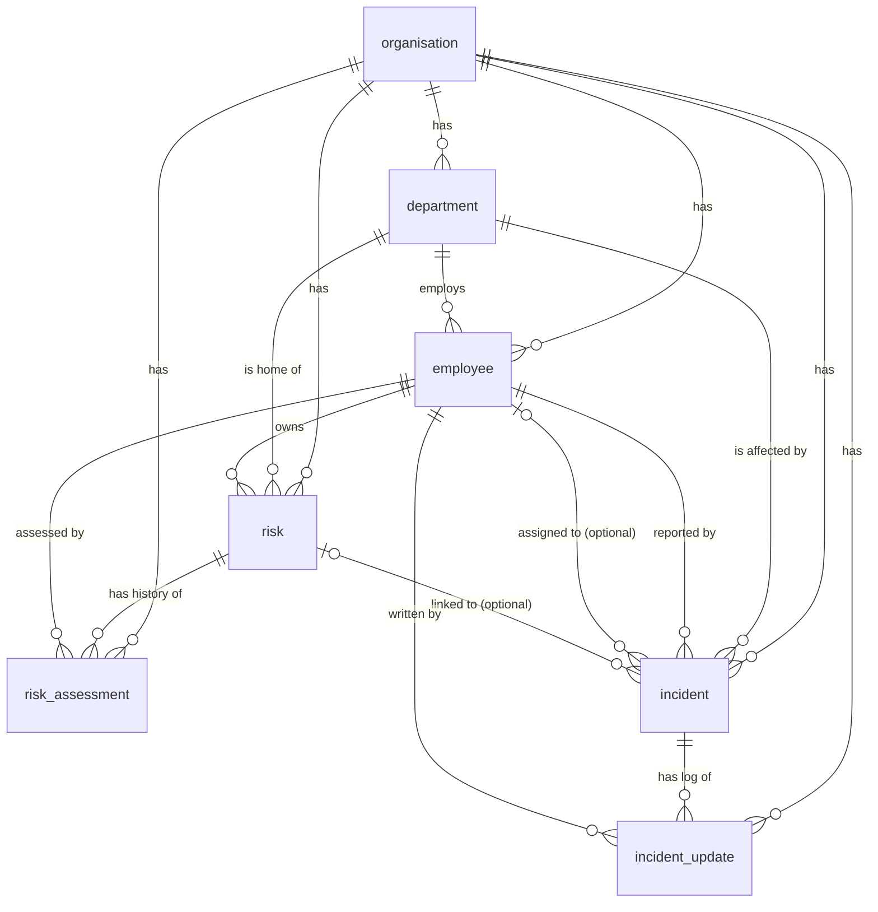

# Database schema

MySQL 8.0.16 or newer (CHECK constraints are only enforced from that version; window functions and generated columns are used).
The schema lives in ordered migration files in [`apps/api/database/migrations`](../apps/api/database/migrations); this page explains it.

Status: written and checked as text by automated tests. The proof run on a real MySQL server is recorded in
[`db-verification.md`](db-verification.md) once it has been done (see that file for its current state).

## How tenancy works

Every customer company is one **organisation**. Everything else belongs to exactly one organisation, and the
database itself stops one organisation's rows from pointing at another's:

1. Every table except `organisation` has `organisation_id NOT NULL`.
2. Codes, names and emails are unique **per organisation**, through composite unique keys such as
   `UNIQUE (organisation_id, risk_code)`. Two companies can both have `RSK-0001` and the same department code `FIN`.
3. Every table also has `UNIQUE (<primary key>, organisation_id)`. Other tables reference it with a **composite
   foreign key** `(<id>, organisation_id)`. A risk in organisation 1 therefore cannot name an owner from
   organisation 2: the pair `(owner id, 1)` does not exist, so MySQL rejects the row.
4. Optional links (`incident.assigned_to`, `incident.risk_id`) may be NULL. With a composite key, a NULL column means
   "not checked" (MATCH SIMPLE), so unassigned and unlinked incidents stay valid, while any value that is present
   must belong to the same organisation.
5. Both views expose `organisation_id`, and every reporting query in `queries.sql` filters on it.

This is data-level isolation only. Logging in, and making the server check who may see what, is Phase 3.

## Entity relationships

## Data dictionary

All ids are `INT UNSIGNED AUTO_INCREMENT`. Every table below also has `organisation_id` (see above), which is not repeated.

### organisation
| Column | Type | Notes |
| --- | --- | --- |
| organisation_id | INT UNSIGNED PK | |
| name | VARCHAR(150) | |
| slug | VARCHAR(60) UNIQUE | url-safe handle; CHECK `^[a-z0-9]+(-[a-z0-9]+)*$` |
| is_demo | BOOLEAN | the sample organisation: sample data and a fixed clock |
| created_at | DATETIME | |

### department
`code` VARCHAR(10), `name` VARCHAR(100). Unique per organisation: `(organisation_id, code)` and `(organisation_id, name)`.

### employee
`employee_code` (EMP-1042), `department_id`, `first_name`, `last_name`, `email`, `job_title`, `role`, `is_active`.
`role` is one of **Org Admin, Risk Officer, Department Head, Auditor, Employee**. Unique per organisation: code and email.
Employees are deactivated, never deleted.

### risk
`risk_code` (RSK-0001), `title` (at least 5 characters), `description`, `category`, `department_id`, `owner_employee_id`,
`status`, `identified_date`, `created_at`, `updated_at`.
- `category`: Operational, Financial, Compliance, Technology, Strategic, Reputational.
- `status`: Identified, Assessed, Mitigating, Monitoring, Closed (default Identified).
- There is **no score column**. The current score is whatever the latest assessment says.
- The owner may work in any department: a Risk Officer can own risks across departments. (There is deliberately no rule tying the owner to the risk's department.)

### risk_assessment (append-only)
`risk_id`, `assessed_by`, `assessment_date`, `likelihood` 1–5, `impact` 1–5, `risk_score`, `mitigation_notes` (optional).
`risk_score` is a **generated, stored column** = likelihood × impact; it cannot be written. Triggers refuse UPDATE and DELETE.

### incident
`incident_code` (INC-0001), `title`, `description`, `severity` (Low, Medium, High, Critical), `status`
(Open, Investigating, Contained, Resolved, Closed; default Open), `department_id` (affected), `reported_by`,
`assigned_to` (optional), `risk_id` (optional), `occurred_at`, `reported_at`, `resolved_at` (optional).

CHECK constraints: `reported_at >= occurred_at`; `resolved_at` is empty or not before `occurred_at`; and
**`resolved_at` is set exactly when the status is Resolved or Closed** (reopening clears it).

### incident_update (append-only)
`incident_id`, `updated_by`, `update_text`, `status_from` and `status_to` (both optional: empty for entries that do not
change the status, such as an assignment, a risk link or a progress note), `created_at`. Triggers refuse UPDATE and DELETE.

## Views

| View | What it gives |
| --- | --- |
| `v_risk_current` | Each risk with its **latest** assessment (newest date, highest id on a tie), its department and owner names, and a computed `severity_band`: Low 1–4, Medium 5–9, High 10–16, Critical 20–25, or Unrated if never assessed. (17–19 cannot occur: they are not a product of two numbers from 1 to 5.) |
| `v_incident_summary` | Each incident with reporter, assignee (NULL if none), department, linked risk code (NULL if none) and `hours_to_resolve`. |

## Triggers

| Trigger | Rule |
| --- | --- |
| `trg_risk_assessment_no_update` / `_no_delete` | Assessment history is append-only. |
| `trg_incident_update_no_update` / `_no_delete` | The incident log is append-only. |

## Normalisation

- **1NF**: every column holds one value. There are no lists or repeating groups; repeated things (assessments, updates) are rows.
- **2NF**: every table has a single-column primary key, so no column can depend on only part of a key. (The extra
  `UNIQUE (id, organisation_id)` keys exist for the composite foreign keys, not as the identity of a row.)
- **3NF**: non-key columns depend only on their own table's key. The current risk score, a fact derived from the
  assessments, is deliberately **not stored** on `risk`: storing it would duplicate information that can go stale. Names
  (department name, owner name) are looked up through keys, not copied.
- `risk.department_id` (the department the risk belongs to) and the owner's department are independent facts, so
  neither can be derived from the other and nothing is duplicated. A Risk Officer can own risks in several departments.

## Lifecycles

Both are enforced in the application (`packages/shared`) and tested; the database enforces the value lists and the
timing rules (including that `resolved_at` is set exactly when an incident is Resolved or Closed), not the order of transitions.

**Incident:** Open → Investigating → Contained or Resolved; Contained → Resolved; Resolved → Closed, or back to Investigating (reopen).
Resolving needs a resolution note and sets `resolved_at`; reopening clears it. **Closed is final**: no notes, no reassignment, no link changes.

**Risk:** Identified → Assessed (needs at least one assessment) → Mitigating or Monitoring (these two can switch back and forth);
any status → Closed (needs a note); Closed → Monitoring (reopen).

## Migrations

Files are named `NNNN_name.sql`, numbered from 0001 with no gaps. The runner (`npm run db:migrate`) records each applied file in
`schema_migrations` with a SHA-256 checksum, applies only what is pending, and **refuses to continue if an already-applied file was
edited**: a change to the schema is always a new migration. Commands:

| Command | What it does |
| --- | --- |
| `npm run db:migrate` | Create the database if needed and apply pending migrations. |
| `npm run db:status` | Show applied and pending migrations. |
| `npm run db:seed` | Load the sample organisation (generated from `packages/shared/src/demo/seed.ts` by `npm run db:seed-sql`). |
| `npm run db:reset -- --yes` | Drop the database. Refuses names that do not look like dev or test databases, unless `--force` is added. |
| `npm run db:verify` | Build a throwaway `<DB_NAME>_verify` database and try to break every rule. See `db-verification.md`. |

Connection details come from `.env` (copy `.env.example`); nothing is hardcoded.
